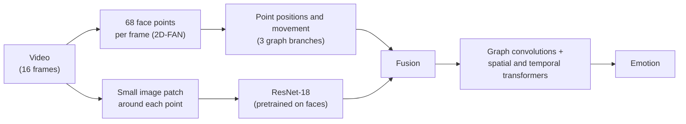

# Facial Expression Recognition from Videos

A deep learning model that watches a short video of a face and says which emotion it shows
(happy, sad, angry, surprised...). Instead of looking only at the pixels, it follows **68 points
on the face** (eye corners, mouth corners, eyebrows...) and how they move over time, and adds
what the skin around each point looks like.

I built this at the **CRIStAL lab (Université de Lille), 3D SAM & FOX teams**, supervised by
Tanmoy Mondal and Deise Santana Maia, in two steps:

1. **M1 research project**: rebuild from scratch the Graph-Tran model
   of Zhao et al. (2023), whose code was never published, and test it on one dataset (CK+).
   This version is on the [`research-project`](../../tree/research-project) branch.
2. **Internship**: test it on 5 datasets, find out why it does worse on
   real-life videos, and try new ideas to close the gap. This is the `main` branch (this page).

The full story is in the reports: [`Report/internship.pdf`](Report/internship.pdf) and, on the
other branch, the research project report.

**In short:** Python, PyTorch, PyTorch Geometric, graph neural networks (GCN), transformers,
ResNet, OpenCV, training on a GPU server.

## Results

Accuracy on 5 datasets. The first three are recorded in a lab (people facing the camera, good
light). The last two are clips from movies and TV shows ("in the wild"), which is much harder.

| Dataset | Type | Baseline (my rebuild) | Best with my changes | Original paper |
|---|---|---|---|---|
| CK+ | lab | 92.44% | **96.62%** | 98.78% |
| Oulu-CASIA | lab | 82.50% | – | 89.17% |
| eNTERFACE05 | lab | 53.39% | – | 54.62% |
| AFEW | movies | 38.64% | **46.48%** | 51.17% |
| CAER | TV shows | 48.31% | – | 77.06% |

"–" means there was no time left in the internship to run my changes on that dataset.

What this shows:
- **On lab data, the rebuild matches the paper closely**, already with the baseline.
- **On real-life clips, it starts far behind.** My changes to how the model looks at the face
  raised AFEW from 38.64% to 46.48%, but did not close the gap with the paper.
  The rest of the gap I could not fully explain. My best guess is details of the training
  setup that the paper does not describe.

## How the model works



- The face points form a **graph**: each point is a node, and points that belong together
  (the corners of the same eye, the outline of the mouth) are connected.
- For each point the model uses three things: where it is compared to the nose, where it is
  inside its own part of the face (mouth, eye...), and how much it moved since the last frame.
- **Graph convolutions** let each point share information with its neighbours. **Transformers**
  then let every point look at every other point, and every frame at every other frame.
- An attention step learns which parts of the face (the mouth for a smile, the eyebrows for
  surprise) and which frames (the peak of the expression) matter most.

## What I did during the internship

**More datasets.** I wrote one small adapter per dataset, so the same code can train on CK+,
Oulu-CASIA, eNTERFACE05, AFEW and CAER. CAER has about 13,000 clips and does not fit in memory,
so I added a loader that reads one clip at a time from disk.

**Fine-tuning the image encoder.** At first the ResNet that reads the patches was frozen.
Training it together with the rest of the model raised AFEW from 29.77% to 38.64%. For this,
patches can now be cropped from the raw frames during training, and the face points can be found
again on each augmented frame, so the point positions and the patches always match.

**Looking at the whole face, not only small patches.** The paper only looks at tiny 49×49 pixel
patches around each point. I tried several ways to also
give the model the whole face:

| Way of reading the face (AFEW) | Accuracy |
|---|---|
| Small patches only (paper) | 38.64% |
| One summary of the whole face, given to every point | 41.51% |
| Features taken from the whole-face image at each point's position | 43.08% |
| Same, at 3 levels of detail | 45.17% |
| **Two paths, patches and whole face, that exchange information (inspired by FragNet)** | **46.48%** |

**Connecting the same point across frames.** I added graph edges that link each face point to
itself in the next frame, and compared three ways of combining them with the normal edges.

**Ideas that did not help** (also worth knowing):
- Five other ways of normalizing the point positions: the paper's own method stayed the best.
- Making the patches bigger (scaling them up to 224×224) did not help either.
- Turning all components on at once (38.90%) was worse than a good pair of them.

**A bug worth sharing.** The pretrained ResNet-18 was trained on images that were *not*
normalized with the usual ImageNet values, but the code normalized them by default. That
silently made its features worse. Always pass `--encoder_imagenet_norm false` with this checkpoint.

## The two branches

| Branch | What it contains |
|---|---|
| `main` | Internship version: 5 datasets, new appearance encoders, on-the-fly data, results and report |
| [`research-project`](../../tree/research-project) | M1 research project version: the first rebuild of Graph-Tran, CK+ only (92.98%) |

## Data

No data or model weights are in this repo. The datasets need permission from their authors:
[CK+](http://www.jeffcohn.net/Resources/), Oulu-CASIA, [eNTERFACE05](https://enterface.net/enterface05/emotion.html),
AFEW (EmotiW challenge) and [CAER](https://caer-dataset.github.io/).
The FER+ pretrained ResNet-18 comes from [Emotion-FAN](https://github.com/Open-Debin/Emotion-FAN).

## Running it

The code was written to run on the lab's GPU server, so the default paths in the `Makefile`
point there. Change `CHEMINS_REPERTOIRE_DONNEES` and the checkpoint paths to your own folders.

```bash
pip install -r requirements.txt

make landmarks dataset=CK+       # find the 68 face points in every frame
make patches   dataset=CK+       # read the patches with the ResNet (fast mode)
make train     dataset=CK+ graph_type=g_topologique
```

[`docs/LAB_GUIDE.md`](docs/LAB_GUIDE.md) is the full guide I wrote for the lab and for the next
students: every dataset, every training mode, every command-line option, and the exact commands
behind each result.

## Files

```
train_gnn_paper.py        training script (all options are defined at the bottom)
models/gnn_paper.py       the model: graph branches, attention, transformers, appearance encoders
executor/trainer_paper.py training loop (cross-entropy + center loss)
dataloader/               building the graphs, loading clips, on-the-fly patches and points
datasets/                 one adapter per dataset
preprocessing_exp_faciale.py, extract_patches.py, precompute_bboxes.py, organize_*.py
                          data preparation steps
Results/                  plots, confusion matrices and settings of the reported runs
Report/internship.pdf     internship report
docs/LAB_GUIDE.md         detailed lab guide
```

## Credits

- Original method: R. Zhao, T. Liu, Z. Huang, D.P.K. Lun, K.M. Lam, *Spatial-Temporal Graphs Plus
  Transformers for Geometry-Guided Facial Expression Recognition*, IEEE Transactions on Affective
  Computing, 14(4), 2023.
- Face point detector: 2D-FAN, by Bulat and Tzimiropoulos (ICCV 2017).
- FER+ ResNet-18 checkpoint: Emotion-FAN, by Meng et al.
- The dual-pathway encoder is adapted from FragNet, by He and Schomaker (2020).
